# Alpha25 模拟器流程检查与真机补充

2026-10-30。测试既有签名 Release APK **Alpha25/code32**，构建源码 `cbe36c4`，交付收口 `e4eef2e`；SHA256 `7acb2228a3db6479cadadd495e3161013643aeb8ecbf5f10e17512f426ce98e1`。本轮没有修改生产代码或重建 APK，以下缺陷均为待修复项。

## 环境与执行范围

- 模拟器：登记的 Android 35 AVD，独立数据盘、无快照；通过模拟器宿主地址访问只监听本机的临时端口18766。复用项目隔离夹具与真实 Python Server1.6.4，独立数据库；生图接口为受控合同夹具，两套配对共用该夹具地址，不代表真实双服务联通。
- 样本：合成几何图片、既有3秒合成视频；通过4秒延迟、预览404、6→8张增量构造可重复场景。仅对合成图片执行一次保留及撤销，回执均200；无真实媒体写入或删除。
- 真机：用户随后连接 USB 手机，先核对 Alpha23/code30，再对哈希一致的既有 Alpha25 执行 `adb install -r`，返回Success；复查实际code32/Alpha25，原配对保留。不卸载、不清数据，不提交生图审核/评分。
- 工具：Environment登记的ADB、android-ui/uiautomator2，按设备串号操作；层级、截图、HTTP路径/状态/耗时及进度采样留在项目忽略目录。公开截图仅选合成模拟器画面，手机私人标题、详情和原始层级不入Git。

## 路径结果与问题优先级

| 路径 | 观察结果 | 结论与下一步 |
|---|---|---|
| 初次打开→连接 | 未配对首页显示“暂无媒体/检查筛选、已选库及同步”，缺少直接连接入口；入口藏在菜单。连接表单按钮与系统手势条重叠，但实际点击连接成功 | P2：区分首次连接与空库，补连接入口；处理底部安全间距，不能称按钮完全无法点击 |
| 配对→选择库→显示媒体 | 隔离库配对、选择、刷新后封面实际显示；全不选时提示至少选一个库 | 样本路径可用；旧夹具仅覆盖部分目录，不能据此宣称全库计数正确 |
| 下拉刷新 | 延迟4秒，约2.02秒截图已无刷新圈，旧内容被骨架替换；请求记录耗时4.031秒 | P1：绑定真实请求状态，刷新期间保留旧内容；不是出现了文字“成功”提示 |
| 批阅范围 | 勾选目录后再点“选择文件夹”，草稿从选中变未选；**真机同样复现** | P1：重复打开/刷新保留有效草稿；范围列表的路径和大卡片重复，占用空间 |
| 视频播放与进度 | 模拟器3秒样本未取得可靠首帧证据，出现EGL错误但因果未确认。真机硬解码日志多个窗口Render>0；三个已就绪落点约69.4%、31.2%、41.7%，10/8/8次进度采样未见跳回旧位置；画面右滑82.97%→87.61%、左滑61.48%→57.14% | 真机抽样有解码与seek证据；未做逐帧视觉/首帧延迟、全格式全库或长期断线验收，不据此宣称全部视频可播放 |
| 生图浏览→信息 | 模拟器预览/缩略图、提示词、时间、尺寸等实际显示；真机两张样本可打开详情，但均“无可靠关联”，评分按钮禁用 | 基本浏览与无关联评分保护有证据；未给真实图片打分。真机图片解码显示未单独取证 |
| 生图评分面板 | 默认字体、1080×2400模拟器中，每行只有1–4，5分被裁切，层级没有“5” | P1：修正固定标签+五个默认最小宽度按钮的布局；真机因上述无关联样本未打开面板，不冒称真机复现 |
| 后台同步→继续审核 | feed延迟4秒，约1.33秒截图审核按钮禁用，父节点enabled=false | P1：只读同步与审核写入分离；保留写入串行及revision守卫 |
| 预览失败→审核 | 合成预览404、详情成功，保留按钮仍enabled=true；点击后POST200，页面同时显示“已保留”和图片失败 | P1：当前图真实显示成功后才放开审核；旧图回调不得误放开新图 |
| 撤销→队尾追加 | 合成图保留后撤销成功；6→8张后仍停第6张，提示队尾新增2张 | 这组受控路径通过，新图不打断当前位置 |
| 断开→恢复 | 模拟器直接点“断开”即清生图配对，无确认且无已保存连接重试；MediaReview配对在App重启后仍保留 | P1：明确“解除配对”的后果并确认；两套配对隔离有样本证据。真机未执行解除配对 |

根因源码位置及原图缩放、目录搜索/就地批阅、用户文案和长队列资源风险，见[前一轮源码检查](UX_FLOW_REVIEW_20261030.md)。评分裁切直接位于 `NsfwReviewScreen.kt` 的 `ScoreRow`：48dp标签加五个默认最小宽度TextButton置于不可滚动行。其余确认项与前轮代码链一致。建议下一批先处理评分布局、预览就绪门禁、范围草稿，再处理同步状态与刷新，最后整理连接入口和安全间距；本报告不代表这些修复已落地。

## 证据、限制及资源收尾

本轮执行的是定向UI导航、状态断言与请求/解码检查，**没有重跑pytest、JVM、connected全套、Release构建或生产部署**，也不计为统一测试套件全绿。没有吞吐、耗电、千图队列基准，不能声称性能收益、PRODUCTION_READY或REAL_LAN_PASS。真实服务版本未在本轮重新核验。

真机补充仅覆盖现有连接和少量样本。一次追加拖动在视频尚未就绪时留在零附近，未计通过；另一测试手势起点误靠系统返回边缘导致退出，检查后使用安全坐标，属测试操作限制，不当作App缺陷。早期按钮查询遇到加载/动画时序、错误媒体库文字及不支持的parent API，均按实际层级纠正，没有归入产品故障。纵向切片没有前后位置对照，不计专项通过。

忽略目录证据：`review_meta/ux-emulator-20261030/`（run-summary、requests、截图/XML、夹具日志）；`review_meta/phone-ux-20261030/`（run-summary、seek/drag采样、局部解码日志、私有层级）。下方12张合成截图是本次运行原图，按文件哈希核对复制，不混入旧运行截图。

模拟器、临时夹具进程已停止，当时ADB设备/forward及5584/5585/18766监听均为空；之后仅使用用户手机。真机uiautomator已停止，新增forward为空。临时模拟器数据盘清理被自动审批以`blocked by policy`拒绝，未删除、未换方法绕过；约1.1GB逻辑大小临时盘保留，进程内存已释放。两个生产服务均未停启或升级。

## 本次合成截图

| 首次打开 / 连接按钮 | 刷新未完成 / 范围勾选 |
|---|---|
| 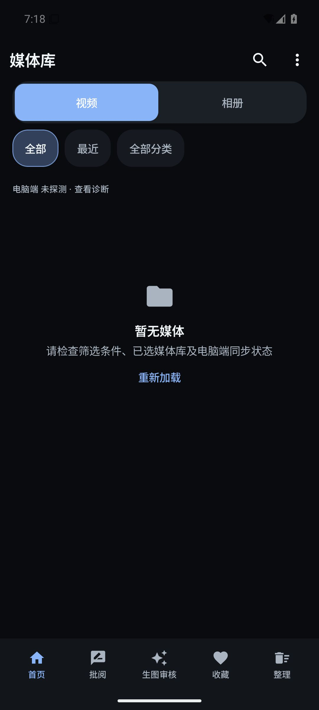 | 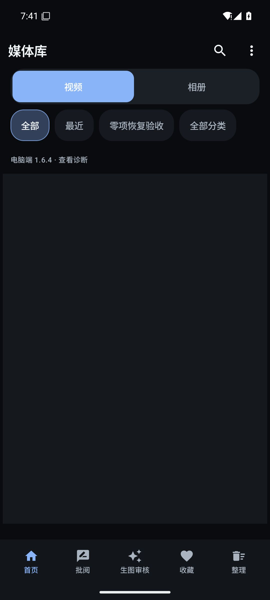 |
| 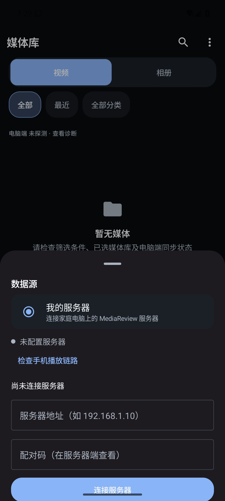 | 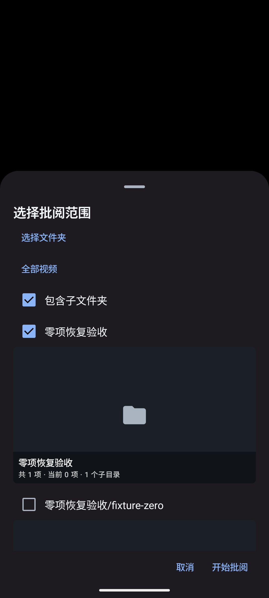 |
| 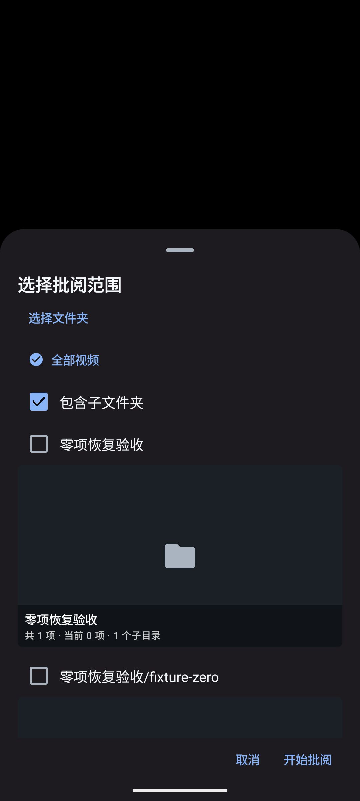 | 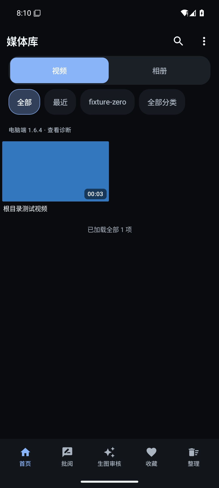 |

| 生图显示 / 同步 | 审核与评分 |
|---|---|
| 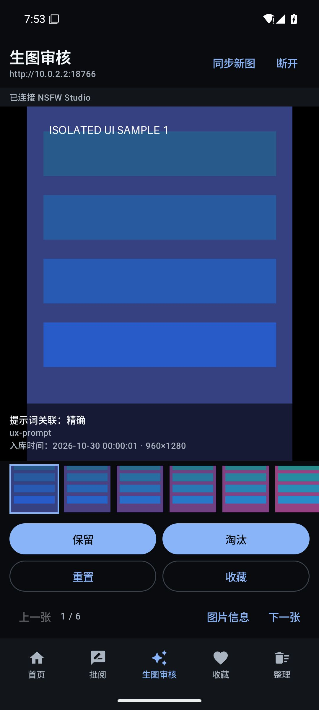 | 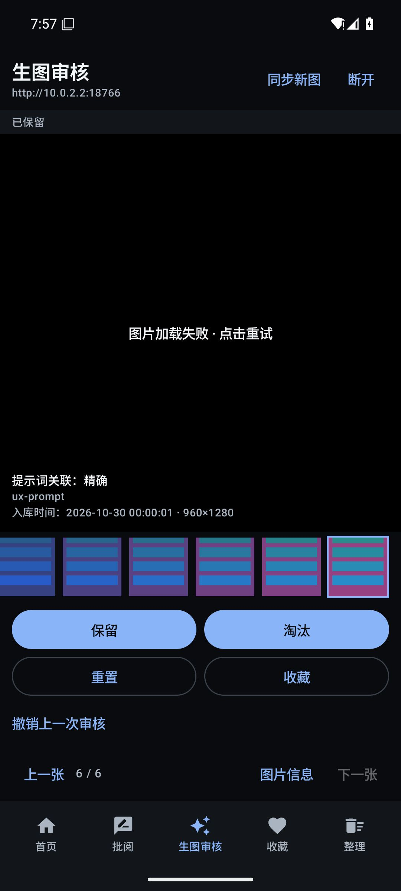 |
| 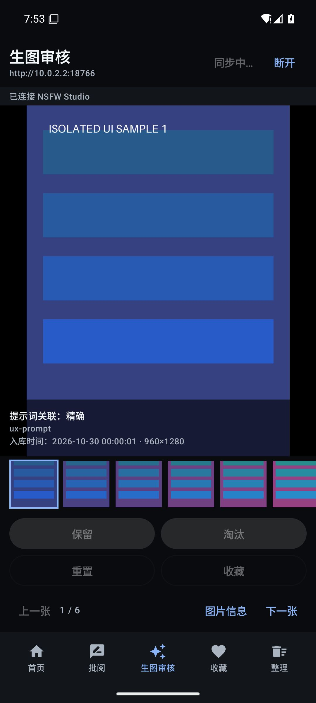 | 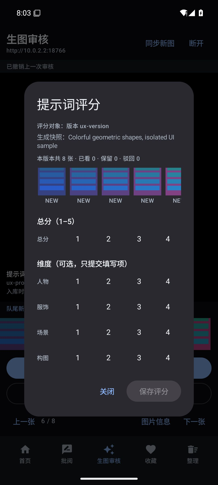 |
| 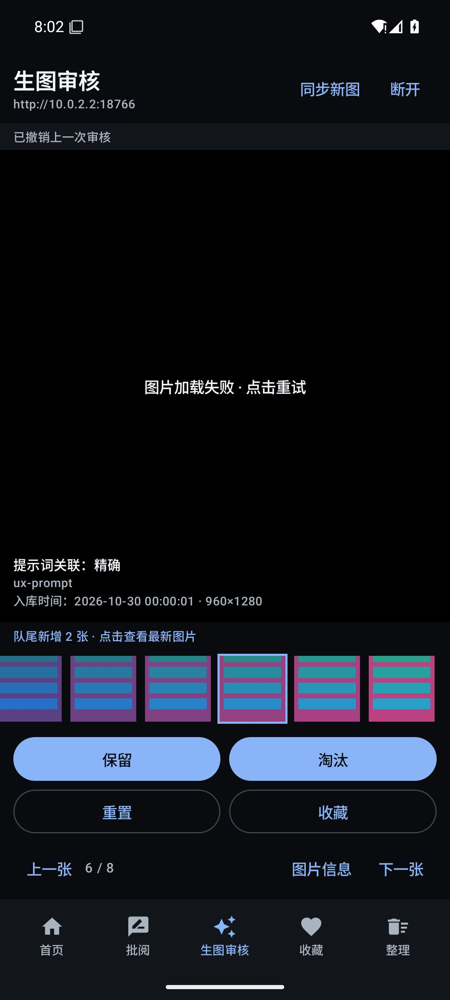 | 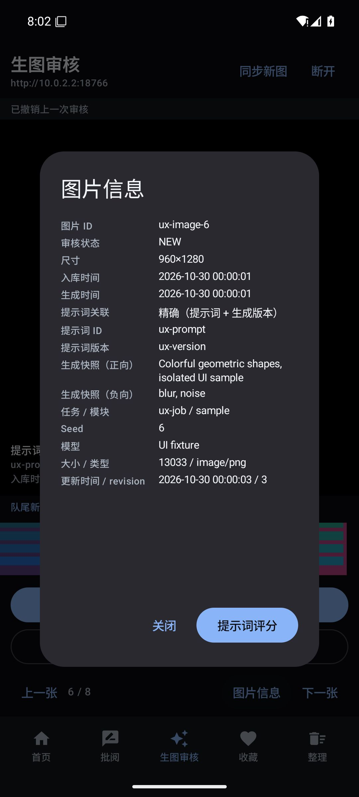 |
